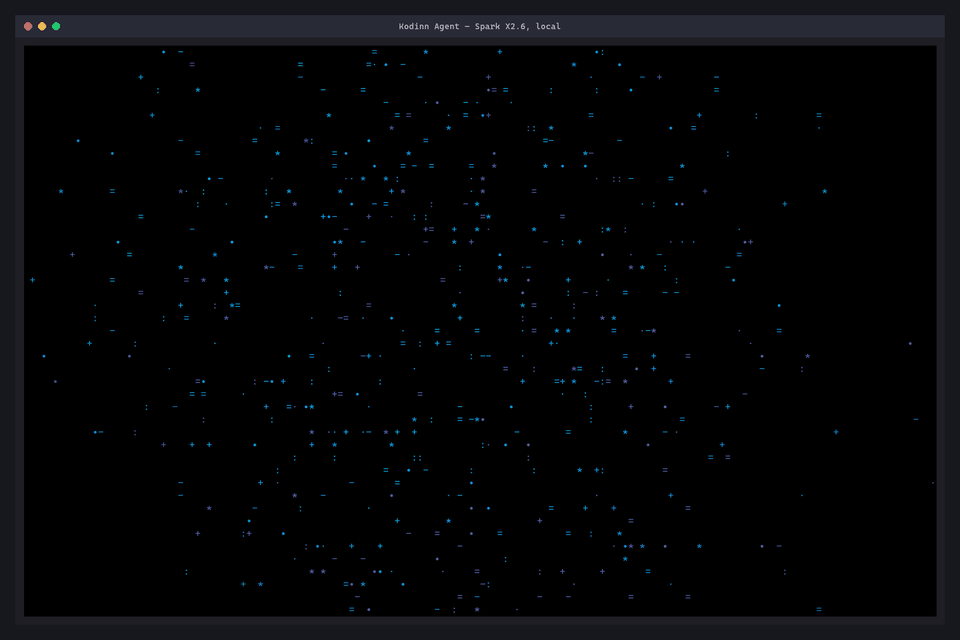
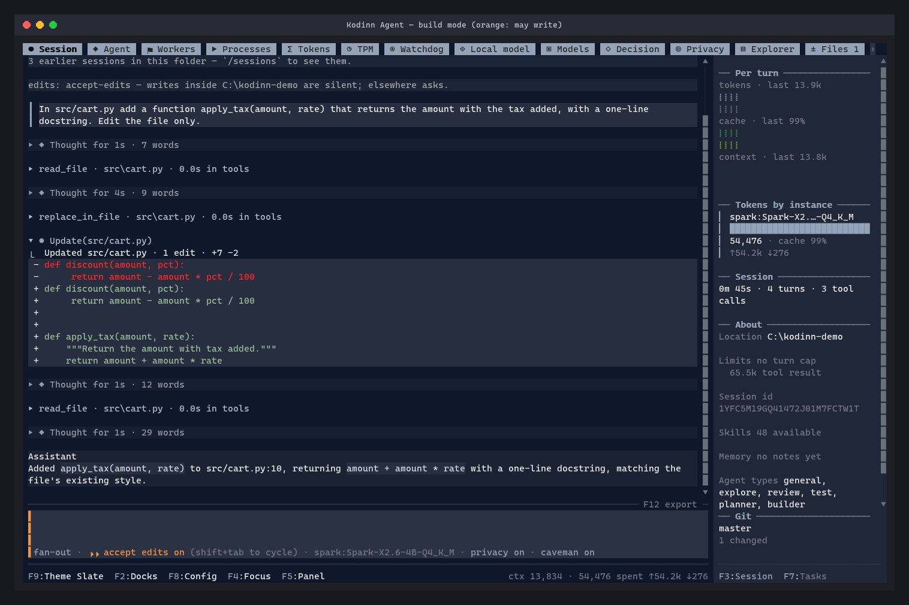
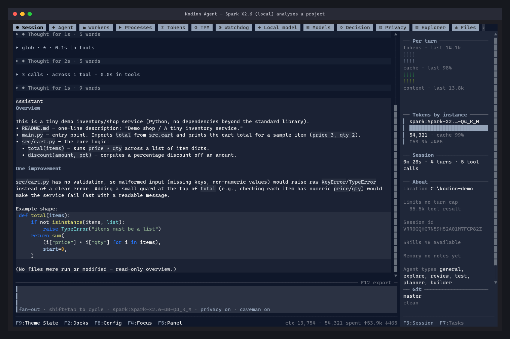
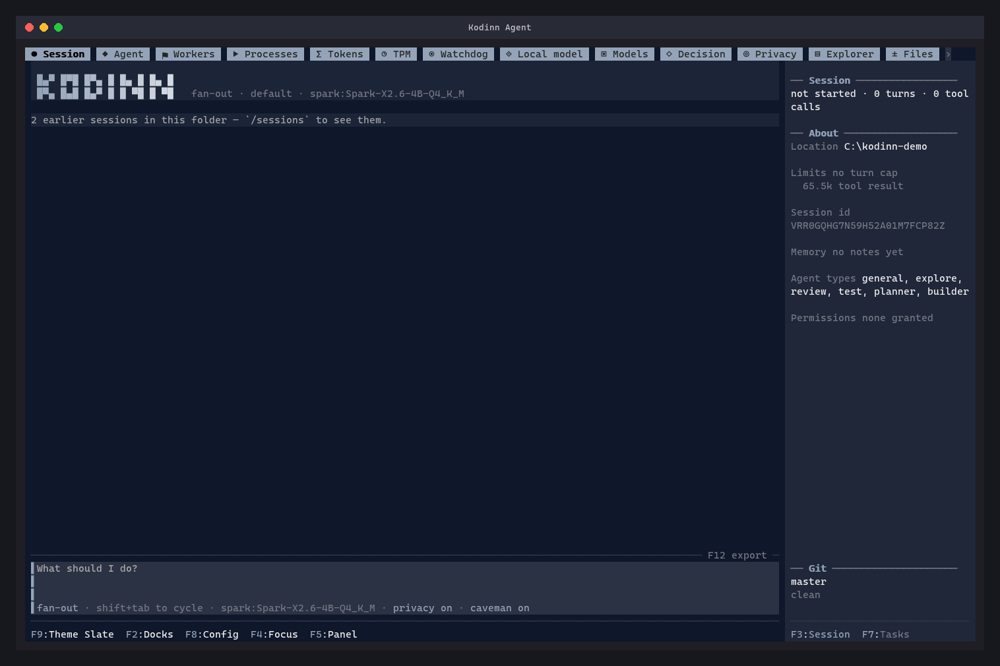
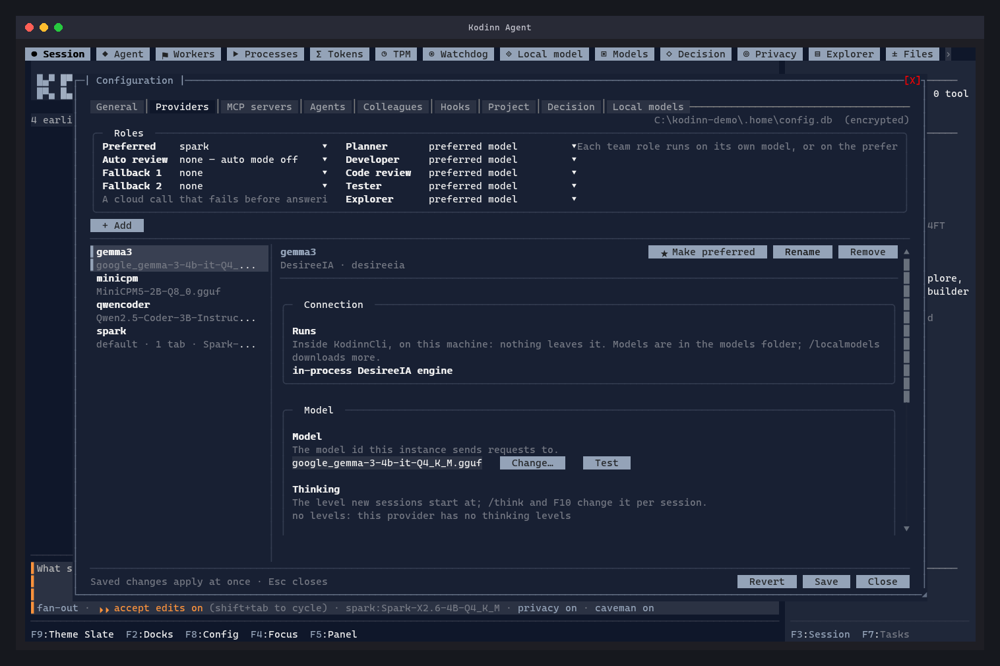
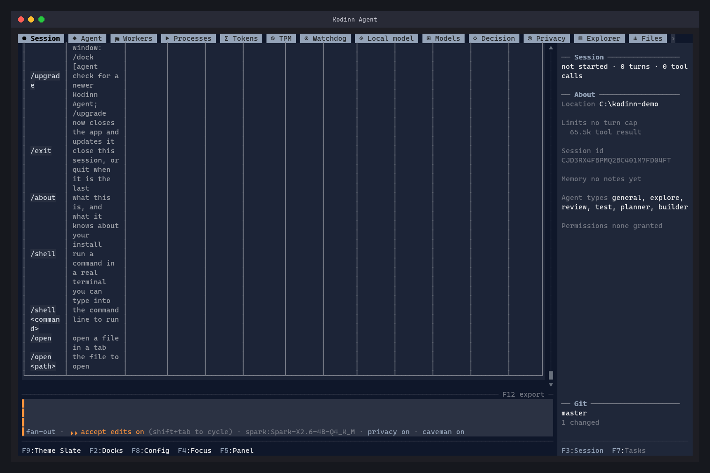
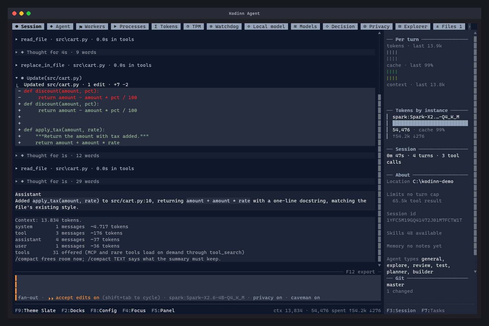
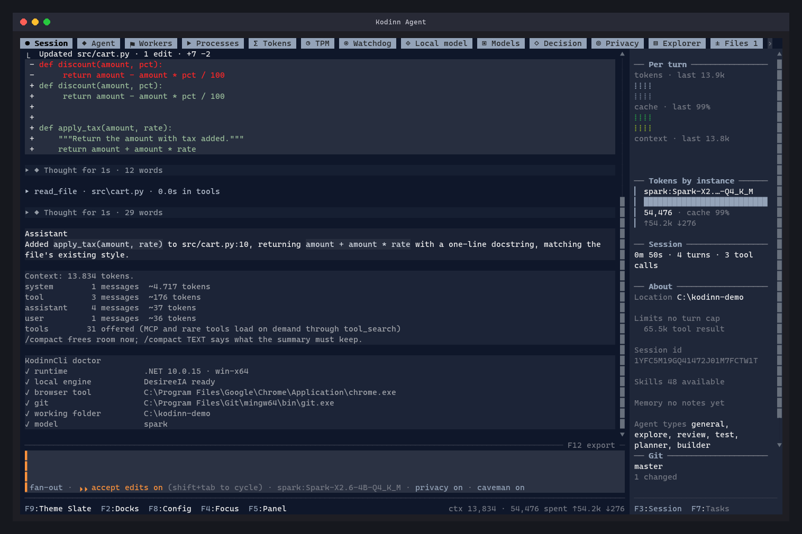

# Kodinn Agent


[](https://www.npmjs.com/package/kodinncli)


Kodinn Agent (`KodinnCli`) is an AI coding agent that lives in your terminal. It reads your project, edits files,
runs commands and tests, and works through git — with **any cloud model, Ollama, or a local model running inside the
app** with no server at all.

It is the terminal edition of **Kodinn**, by Passaro Francesco Paolo — [www.digitalsolutions.it](https://www.digitalsolutions.it).



*Spark X2.6 (4B, running locally inside Kodinn Agent on the DesireeIA engine) reads a project and answers — no cloud,
no server.*

## Get started

**Windows** (PowerShell)

```powershell
irm https://raw.githubusercontent.com/francescopaolopassaro/kodinn-agent/main/install.ps1 | iex
```

**macOS and Linux**

```bash
curl -fsSL https://raw.githubusercontent.com/francescopaolopassaro/kodinn-agent/main/install.sh | bash
```

**npm** (any system with Node.js 18+)

```bash
npm install -g kodinncli
```

**Package managers**

```powershell
# Windows — Scoop
scoop bucket add kodinn https://github.com/francescopaolopassaro/kodinn-agent
scoop install kodinncli
```

```bash
# macOS / Linux — Homebrew
brew tap francescopaolopassaro/kodinn https://github.com/francescopaolopassaro/kodinn-agent
brew install kodinncli
```

Then open a terminal in your project and run:

```bash
kodinn
```

The first run guides you through choosing a model: a cloud provider (paste an API key), Ollama, or a local model
that `/localmodels` downloads for you. Every package is self-contained — .NET does not need to be installed.

| System | Package |
|---|---|
| Windows x64 | `KodinnCli-<version>-win-x64.zip` |
| Linux x64 / arm64 | `KodinnCli-<version>-linux-x64.tar.gz`, `…-linux-arm64.tar.gz` |
| macOS Apple Silicon / Intel | `KodinnCli-<version>-osx-arm64.tar.gz`, `…-osx-x64.tar.gz` |

Packages and their SHA-256 are listed in [`latest.json`](latest.json) and served from
`https://www.digitalsolutions.it/downloads/kodinncli/`. Kodinn Agent updates itself: it tells you when a new version
is out, and `/upgrade now` closes it and updates it through the channel you installed it with.

## What it does



**An agent that works on your code.** Give it a goal in plain language. It reads the files it needs, changes them
(every write shows its diff), runs your build and tests, and uses git. Anything outside your working folder asks first.

**Every model, cloud and local.** Anthropic, OpenAI, OpenRouter, Google Gemini, DeepSeek, Groq, Mistral, xAI,
Together, Perplexity, Cohere, NVIDIA, Fireworks, Cerebras, DeepInfra, SambaNova, Baseten, **Ollama server**,
**Ollama Cloud** and any OpenAI-compatible endpoint — chosen per session, with a failover chain that moves a turn to
the next provider when one fails.

**Local models with no server.** The built-in **DesireeIA** engine runs `.gguf` models inside the app, on CPU or NVIDIA
GPU. `/localmodels search` finds models on Hugging Face and `/localmodels download` fetches one with checksum
verification. Tools, sub-agents and plan mode work with local models too.

**Modes you can see.** `Shift+Tab` cycles the working mode and the bar beside the prompt takes its colour:
**always-ask**, **plan** (teal — read-only: the agent investigates and writes the plan), **build** (orange — edits
inside the folder without asking) and **auto** (red-orange). `/ultraplan` plans at the deepest thinking level;
`/team` runs builders, a reviewer and a tester in parallel until build and tests pass.

**Sub-agents and colleagues.** Agents run in parallel tabs, in the background, or in isolated git worktrees.
Colleagues are agents that learn across sessions and can be brought back with what they know.

**Code intelligence.** The `lsp` tool asks a language server — Roslyn for C#, TypeScript, Python, Go, Rust, C/C++,
Java — for definitions, references, types and compiler errors. `notebook_edit` edits Jupyter cells.

**Test anything, in a real browser.** The `browser` tool drives Chrome or Edge to open a site or a local web app,
click, type, read the console and the network, and take screenshots — or attaches to an Electron app.

**Scheduled work.** `cron_create` brings a prompt back on a schedule ("every 10 minutes check the build").

**Private by design.** Settings and conversations are stored **encrypted**. **PrivacyGuard** masks personal data
before it reaches a cloud model and restores it in the answer; **Caveman** compresses large tool results.

**Extensible.** Skills in Markdown (`SKILL.md` — compatible with Claude Code and OpenCode skills) and a skills market,
MCP servers, hooks, custom commands, output styles, plugins.

**Scriptable.** `kodinn -p "…"` runs one task and exits; `--input-format stream-json --output-format stream-json`
lets another program drive it, permission questions included.

## Screenshots

| | |
|---|---|
|  |  |
| A local model analyses a project | The start-up splash |
|  |  |
| Providers and roles (F8) | Keys and commands (F1, `/help`) |
|  |  |
| `/context` — what fills the model's context | `/doctor` — installation check |

## Commands

The most used ones — the full list, with every sub-command, is in [docs/COMMANDS.md](docs/COMMANDS.md).

| Command | What it does |
|---|---|
| `/model [name]` | show or switch the model of this session |
| `/plan`, `/build`, `Shift+Tab` | working mode: plan (read-only), build (edits), auto |
| `/ultraplan GOAL` | plan at the deepest thinking level with parallel exploration |
| `/team TASK` | plan, then builders + reviewer + tester until build and tests pass |
| `/compact [focus]` | summarise the conversation to free context |
| `/context` | what fills the context and how full it is |
| `/review`, `/security-review` | review the pending changes for bugs or security problems |
| `/diff`, `/git` | the working tree's changes; git status, commit, branch, push, pull… |
| `/revert`, `/rewind` | undo the agent's file changes from a checkpoint |
| `/sessions`, `/resume`, `/branch` | earlier conversations; continue one; fork this one |
| `/localmodels` | search and download local models from Hugging Face |
| `/skills market` | browse and install skills from GitHub |
| `/mcp`, `/hooks`, `/plugin` | MCP servers, hooks and plugins |
| `/privacy`, `/caveman` | PrivacyGuard masking; tool-result compression |
| `/add-dir PATH` | let the agent work in another folder too |
| `/output-style NAME` | how the agent writes: explanatory, learning, concise or your own |
| `/vim`, `/statusline CMD` | vi keys in the prompt; your own status line |
| `/doctor`, `/upgrade` | check the installation; update it |

## Keys

| Key | What it does |
|---|---|
| `Shift+Tab` | cycle the working mode |
| `Enter` / `Shift+Enter` | send / new line |
| `Esc` | stop the agent |
| `Ctrl+S` | put the draft aside, and bring it back |
| `Ctrl+X Ctrl+K` | stop all background agents |
| `F1` help · `F2` docks · `F3`/`F7` session/tasks panel · `F5` side panel · `F8` settings · `F9` theme · `F10` thinking level | |
| `Shift+F8` / `Shift+F9` | PrivacyGuard / Caveman on and off |

## Updating

Kodinn Agent checks for a new version once a day (`KODINNCLI_NO_UPDATE_CHECK=1` turns it off). `/upgrade` tells you
what is available; `/upgrade now` closes the app and a separate update process takes over:

| Installed with | Updated with |
|---|---|
| install script / zip | download from digitalsolutions.it, SHA-256 check, files replaced |
| Scoop | `scoop update kodinncli` |
| winget | `winget upgrade DigitalSolutions.KodinnAgent` |
| Chocolatey | `choco upgrade kodinncli` |
| Homebrew | `brew upgrade kodinncli` |
| npm | `npm install -g kodinncli@latest` |

## Reporting bugs

Open an [issue](https://github.com/francescopaolopassaro/kodinn-agent/issues) with the output of `/doctor`, what you
did and what you expected. `/heapdump` adds memory figures for performance problems.

## Data and privacy

Kodinn Agent sends your prompts and the files the agent reads **only to the model provider you choose**. With a local
model nothing leaves your machine. Settings, API keys and conversations are encrypted at rest with a key bound to your
machine and user. The update check reads `latest.json` and sends nothing about you.

## License

[MIT](LICENSE) © Passaro Francesco Paolo — this repository holds the install scripts, the package-manager manifests
and the documentation; the binaries are published at [www.digitalsolutions.it](https://www.digitalsolutions.it).
